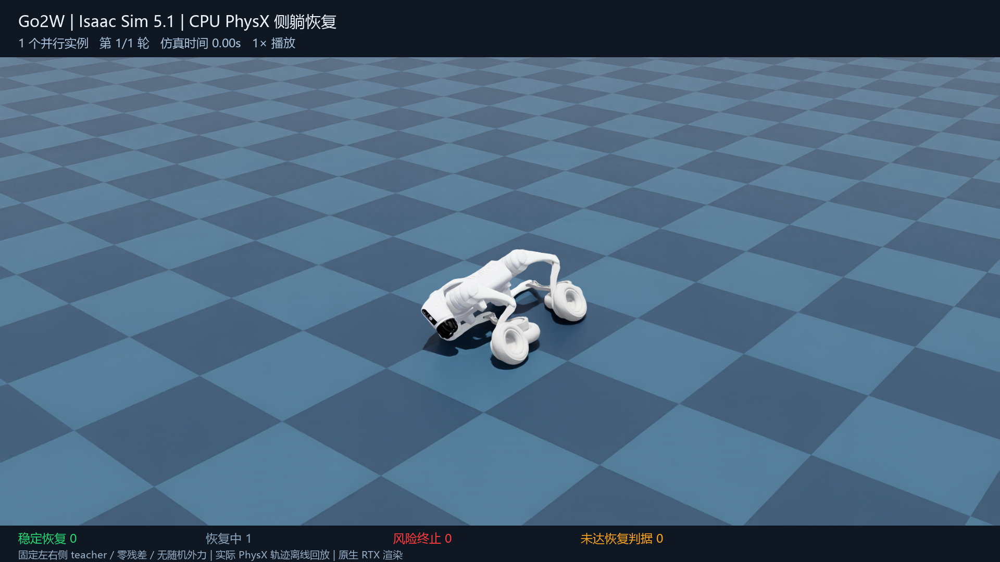
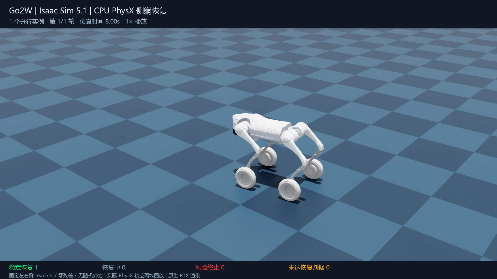
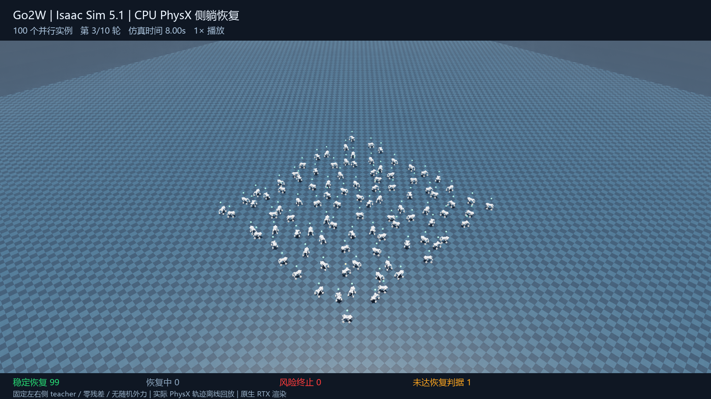

# Go2W 倒地恢复：个人电脑仿真复现与百台评估

[返回作品集](../README.md) · [公开版报告 PDF](../docs/go2w-public-report.pdf) · [汇总结果 JSON](../assets/04-go2w/results-summary.json)

**乔天宇 · 运动控制算法作品集 · 2026-10-15 实测 / 2026-10-16 发布**

本页补充 Go2W 在职项目概要，展示本人在个人电脑上完成的仿真复现与评估结果。
公开内容为仿真视频、截图、测试范围及汇总指标；企业项目实现及训练资料不在此发布。

## 先看演示

### 精简展示 · 48.5 秒

<!-- go2w-showcase-player:start -->

https://github.com/user-attachments/assets/bf37c138-6a79-4142-97a5-4425c52879b8

<!-- go2w-showcase-player:end -->

内容依次为单台近景、百台第 1 / 3 轮精选、单独标注的自然跌落探索。

### 完整百台演示

时长：95 秒。

<!-- go2w-full-player:start -->

https://github.com/user-attachments/assets/4a142ce4-21b2-4205-9c22-3c6b8a2f91eb

<!-- go2w-full-player:end -->

保留全部 1,000 个案例；1 倍仿真时间播放，每轮包含 0.5 秒起点停留、8 秒动作与 1 秒终点停留。
视频基于正式原生 CPU PhysX 运行中记录的位姿和关节状态，离线使用原生 RTX 渲染；回放期间不继续求解物理，百台采用紧凑展示布局。
画面统一采用深蓝棋盘格地面，便于辨认机器人姿态、地面接触与位移；本次视觉更新使用同一批已记录轨迹。

### 单台近景

时长：9.5 秒，使用正式首轮的一台机器人轨迹。

<!-- go2w-single-player:start -->

https://github.com/user-attachments/assets/32c64075-7b8c-4c67-9a45-b07fee2a2ece

<!-- go2w-single-player:end -->

[精简片 MP4 备用入口](../assets/04-go2w/go2w-showcase.mp4) · [完整片 MP4 备用入口](../assets/04-go2w/go2w-100x10.mp4) · [单台 MP4 备用入口](../assets/04-go2w/go2w-single.mp4)

## 实际完成的验证

- 在个人 Windows 电脑上恢复原生 Isaac Sim 5.1 / Isaac Lab 2.3.2 的 CPU PhysX 仿真运行。
- 对同一组 16 个历史侧躺初态进行 1 / 4 / 16 实例配对回归，比较恢复结果和六类风险标志。
- 冻结样本清单后扩展到 100 个原生机器人实例同时运行，执行 10 轮，共 1,000 个不同初态。
- 保存每回合状态与结果，保留未成功案例，并分别核对正式轨迹、回放位姿和视频解码完整性。

## 正式测试结果

| 项目 | 实测结果 |
|:--|:--|
| 平台 | Windows 原生 Isaac Sim 5.1 / Isaac Lab 2.3.2 / CPU PhysX |
| 并行规模 | 100 个原生 Articulation 同时运行 × 10 轮 |
| 初态 | 1,000 个不同历史侧躺状态；左侧 500 / 右侧 500 |
| 终点稳定恢复 | **997 / 1,000（99.7%）**；左侧 500/500，右侧 497/500 |
| 未达终点判据 | **3 / 1,000**，第 3 / 5 / 6 轮各 1 个 |
| 六类风险标志 | 本次测试均为 **0 触发** |
| 控制条件 | 冻结左右侧 teacher、零残差、无随机外力、无域随机化 |
| 场景实时因子 | **0.902×**，物理 / 控制与轨迹记录共 88.65 秒 |

状态从历史路线适用池中均匀无放回抽取，并排除配对回归样本；没有只选历史成功案例。
但该池经过路线适用性筛选，**不属于新盲测分布，也不覆盖任意跌倒姿态**。

| 已侧躺起点 | 稳定恢复终点 |
|:--:|:--:|
|  |  |

## 成功判据与3个未成功案例

在 8 秒评估终点，机身高度 ≥0.42 m、直立度 ≥0.90、最大腿关节角误差 ≤0.50 rad、最大腿关节速度 ≤0.10 rad/s，
连续保持 0.50 秒（25 个控制步），且未触发六类风险，才记为终点稳定恢复。

三个案例在终点达到单帧阈值，但末尾连续合格步数分别为 **22、14、1 步**，少于 25 步要求。
它们在中途曾有较长的稳定片段，本次仍按终点判据保留为未成功，未改算为“曾经站起即成功”。

风险标志包括背部风险、顶部禁触、前轮翻越、关节限位、工作区及非有限数值。
零触发只描述本次样本和固定配置，不能解释为所有跌倒方式均安全。

## 配对回归与性能口径

| 并行实例数 | 同一组案例数 | 终点稳定恢复 | 物理 / 控制加记录耗时 |
|:--:|:--:|:--:|--:|
| 1 | 16 | 16/16 | 64.14 秒 |
| 4 | 16 | 16/16 | 16.70 秒 |
| 16 | 16 | 16/16 | 5.13 秒 |

三种并行规模的恢复结果与六类风险标志一致，最终高度最大差异小于 1 mm。
16 实例完成同一组回归的耗时约为单实例的 1/12.5；该配对结论只覆盖这 16 个案例。

100 实例正式测试共 10 轮、每轮 8 秒，场景时间轴合计 80 秒，物理 / 控制与记录耗时 88.65 秒：

**场景实时因子 = 80 / 88.65 ≈ 0.902×，略慢于实时。**

启动、重置、压缩与视频渲染未计入该指标；评估全流程约 99.82 秒。
累计机器人秒吞吐不能解释为 100 台实时运行。README 中约 500 Hz 的通信链路频率来自另一项测试，与这里的物理场景速度分开。

## 两种起点分别呈现

| 起点 | 平台 | 本次范围与结果 |
|:--|:--|:--|
| 已侧躺 | 原生 Isaac CPU PhysX | 正式测试 997/1000；3 个终点未达标，六类风险0触发 |
| 自然跌落 | MuJoCo | 探索测试 0/16 成功、15 拒绝、1 超时；尚不能作为成功恢复能力证明 |

自然跌落部分使用探索包装器，完整后期门控尚未复现。两组的控制器、引擎与初态条件不同，不将成功率差异归因于单独的引擎或并行优化。

## 展示边界与来源

本次是本地可完整恢复的冻结左右侧 teacher 测试，未完整复现最新 DAgger15，也不将它表述为端到端 PPO 策略或真机倒地恢复验证通过。
公开材料不含企业项目源码、内部实现、权重、teacher 动作序列、原始状态库或内部日志。

- [公开机器人模型：Unitree MuJoCo](https://github.com/unitreerobotics/unitree_mujoco)
- [Isaac Lab v2.3.2](https://github.com/isaac-sim/IsaacLab/tree/v2.3.2)
- [Isaac Sim 5.1 平台文档](https://docs.isaacsim.omniverse.nvidia.com/5.1.0/index.html)
- [仓库内容说明](../docs/DISCLAIMER.md)

本机约 16 GB 内存与 8 GB 显存低于平台官方最低配置，以上结论以本次实际完成的 CPU 评估为限。
第三方模型及画面中的商标保留原有权利；本页原创说明文档沿用仓库许可证。
